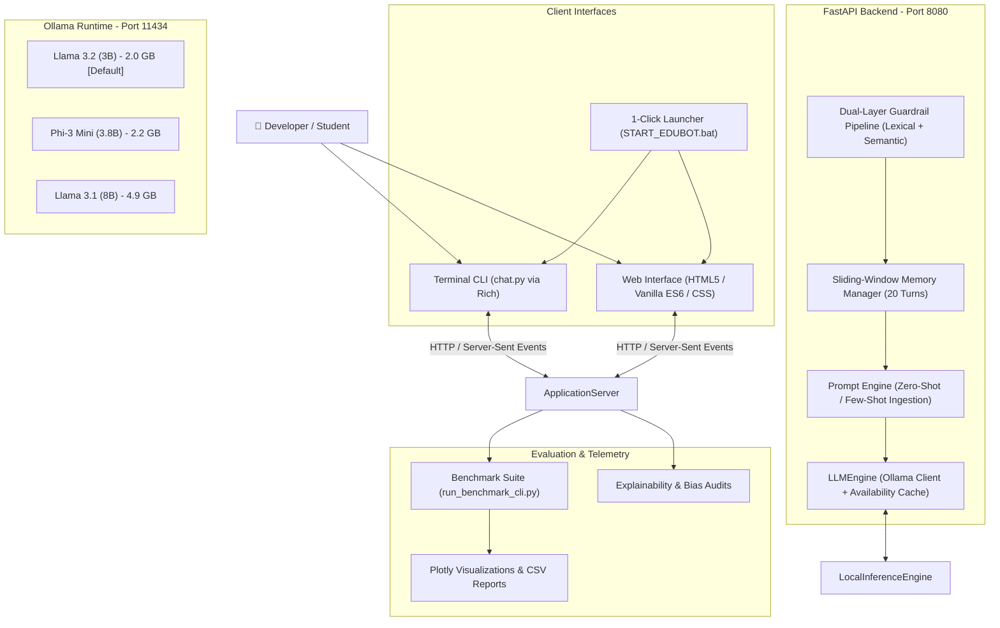

# ARIA — High-Performance Offline AI Assistant using Local LLMs (Ollama)

[](https://www.python.org/)
[](https://fastapi.tiangolo.com/)
[](https://ollama.ai/)
[](https://www.langchain.com/)
[](https://github.com/Textualize/rich)
[](https://opensource.org/licenses/MIT)

> **System Name:** ARIA (Artificially Responsive Intelligent Assistant)  
> **Authors:** Samar Kalkhanday, Mohammad Moomin Bakshi, Sampreeth  
> **Core Architecture:** 100% Offline Edge AI via Local LLMs (Ollama)  

---

## 📌 Executive Summary

**ARIA** is a production-grade, privacy-preserving intelligent conversational assistant that runs **100% locally on consumer hardware** without external cloud dependencies, paid APIs, or internet access. It provides real-time token streaming across software engineering, algorithmic design, AI theory, and systems engineering.

### Key Architectural Highlights:
1. **Goal-Directed Offline Execution:** Operates entirely on localhost with zero network telemetry or data leakage.
2. **State Representation:** Bounded sliding-window context memory ($k = 20$ turns) preventing Transformer KV-cache VRAM saturation.
3. **Dual Prompt Engineering:** Zero-Shot vs structured Few-Shot in-context exemplar prompting with deterministic pre-inference safety guardrails.
4. **Empirical Benchmark:** Comprehensive 75-run evaluation comparing 3 open models (`llama3.2:latest`, `phi3:mini`, `llama3.1:8b`) across 25 standardized technical questions.
5. **Explainability & Responsible AI (XAI / RAI):** Full prompt-chain traces, bias invariance testing, and local data sovereignty guarantees.
6. **Dual Working Interfaces:**
   - **Terminal Mode (`chat.py`):** Interactive rich CLI with ASCII banners, live spinners, real-time streaming, and slash commands.
   - **Web Interface (`run.py`):** Minimalist dark-themed glassmorphism single-page application at `http://127.0.0.1:8080`.
7. **1-Click Windows Launcher (`START_ARIA.bat`):** Automatic port-conflict remediation and environment setup on Windows.

---

## 🏛️ System Architecture



---

## Application Execution and Local Communication Architecture

The Offline AI Assistant supports two methods of interaction: a browser-accessible interface through FastAPI and a terminal-based Command-Line Interface (CLI).

The FastAPI backend handles incoming HTTP requests and exposes endpoints for application functionality and health monitoring. Uvicorn is used to run the FastAPI application locally.

The Python application communicates with the Ollama runtime through HTTP requests on the local machine, using the default Ollama service port **11434**.

- The `/api/tags` endpoint retrieves information about locally available models.
- The `/api/chat` endpoint handles chat-generation requests.
- The `ChatOllama` integration from LangChain connects the language-model logic with Ollama.
- The `/health` endpoint is available for checking the application's operational status.

The CLI (`chat.py`) provides a terminal-based interaction method, allowing users to submit questions and receive generated responses without opening a browser. Both interfaces provide access to the locally hosted AI assistant and support the project's objective of **offline AI deployment**.

---

## 📊 Benchmark Summary: 3 Models × 25 Questions (75 Trials)

Tested on **Intel Core i7 + 16GB RAM + NVIDIA GeForce RTX 3050 6GB Laptop GPU**:

| Model Name | Parameters | Model Size | Avg Latency | Avg TTFT | Quality Score (1–5) | VRAM Footprint | Verdict |
|:---|:---:|:---:|:---:|:---:|:---:|:---:|:---|
| **`llama3.2:latest`** | 3.2B | **2.0 GB** | **5,121 ms** | **323 ms** | **4.90 / 5.0** | **~2,550 MB** | 🏆 **Top Recommendation** |
| **`phi3:mini`** | 3.8B | **2.2 GB** | **9,425 ms** | 1,907 ms | **4.87 / 5.0** | **~2,850 MB** | 🥈 **Deep Reasoning** |
| **`llama3.1:8b`** | 8.0B | **4.9 GB** | **16,771 ms** | 894 ms | **4.90 / 5.0** | **~5,400 MB** | 🥉 **Heavyweight** |

> Complete analysis available in [**`docs/COMPARISON_REPORT.md`**](file:///C:/Users/samba/.gemini/antigravity/scratch/offline-ai-assistant/docs/COMPARISON_REPORT.md).

---

## 🚀 Quickstart Guide

### Option 1: 1-Click Launcher (Windows)
Double-click **`START_ARIA.bat`** in the project folder. It will automatically check dependencies and open:
👉 **`http://127.0.0.1:8080`**

---

### Option 2: Command-Line Execution

#### 1. Install Dependencies
```bash
pip install -r requirements.txt
```

#### 2. Pull the Local Model (via Ollama)
```bash
ollama run llama3.2
```

#### 3. Run Web Assistant
```bash
python run.py
```
Open **`http://127.0.0.1:8080`** in your browser.

#### 4. Run Terminal Chat CLI (Optional)
```bash
python chat.py
```
*Supported in-chat commands:* `/help`, `/model`, `/clear`, `/info`, `/bench`, `/exit`

#### 5. Run Full 3-Model Benchmark (Optional)
```bash
python run_benchmark_cli.py
```

---

## 🔌 Offline Operation Verification

ARIA is designed to function with zero network access:
1. Disconnect your machine from Wi-Fi or unplug your Ethernet cable.
2. Launch `START_EDUBOT.bat` or run `python run.py`.
3. Open `http://127.0.0.1:8080` in your browser.
4. Ask any programming or technical question — ARIA generates complete responses without internet access.
5. All model weights and inference engines reside entirely in `~/.ollama` and local VRAM.

---

## 📸 Screenshots & Evaluation Evidence

Visual proof of the working system is documented in [**`docs/screenshots/SCREENSHOTS_GUIDE.md`**](file:///C:/Users/samba/.gemini/antigravity/scratch/offline-ai-assistant/docs/screenshots/SCREENSHOTS_GUIDE.md):
- **Working Assistant & Streaming:** Clean ChatGPT/Claude-style dark interface.
- **Safety Guardrail Refusal:** Deterministic interception of prohibited queries.
- **Terminal CLI:** Rich interactive interface with ASCII banners and spinners.
- **Benchmark Dashboard:** Multi-model comparative Plotly graphs.

---

## 📁 Repository Structure

```text
offline-ai-assistant/
├── app.py                      # FastAPI REST and Streaming backend server
├── config.py                   # Global system parameters, models, few-shot prompts
├── run.py                      # Production web server entry-point
├── chat.py                     # Rich interactive terminal mode
├── run_benchmark_cli.py        # Automated 75-run multi-model benchmark script
├── benchmark.py                # Core benchmark harness and Plotly chart generator
├── explainability.py           # Explainability traces & Responsible AI bias auditor
├── guardrails.py               # Dual-layer safety & scope guardrail filters
├── llm_engine.py               # Ollama LangChain wrapper with availability caching
├── memory.py                   # Multi-session sliding-window memory manager
├── models.py                   # Pydantic schemas and validation models
├── utils.py                    # Hardware inspection (RAM, VRAM, CPU telemetry)
├── requirements.txt            # Python dependencies
├── docs/
│   ├── PROJECT_REPORT.md       # Master 30-mark AI Project Technical Report
│   └── COMPARISON_REPORT.md    # 3-Model empirical comparative analysis
├── templates/
│   └── index.html              # Modern dark glassmorphism web interface
├── results/
│   ├── benchmark_latest.json   # Full raw JSON benchmark dataset
│   ├── benchmark_latest.csv    # Exported tabular performance metrics
│   └── dashboard_*.html        # Interactive Plotly visual charts
└── venv/                       # Isolated Python 3.11 virtual environment
```

---

## 📄 License
MIT License. Open-source for academic and educational research.
